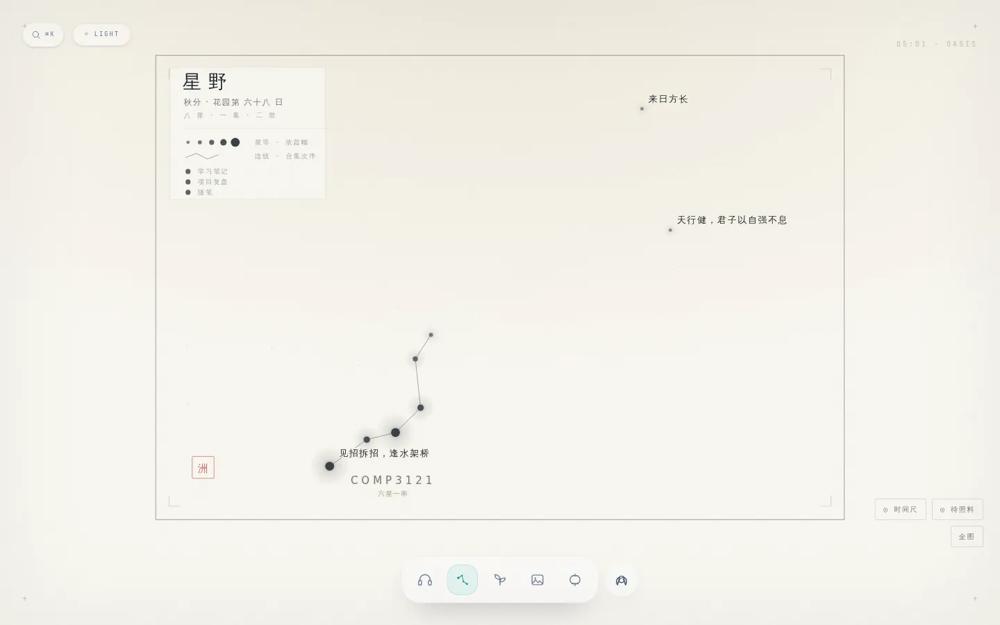
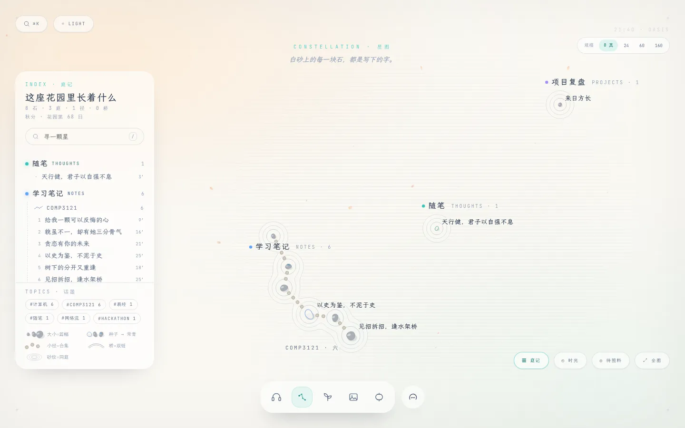
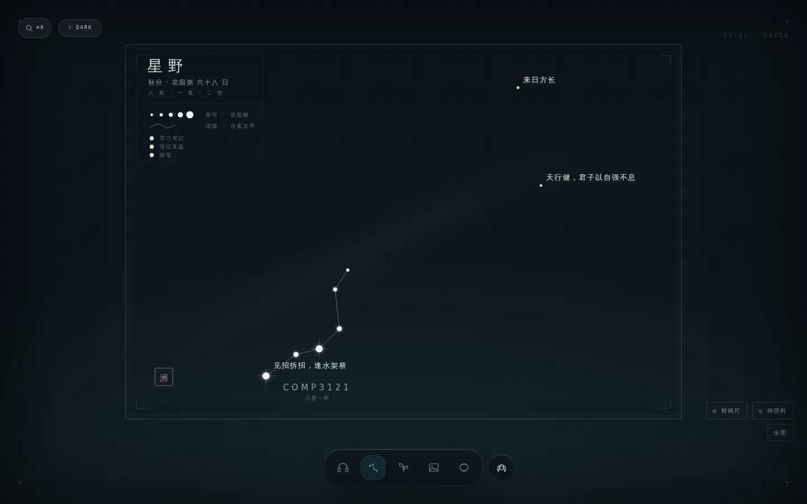
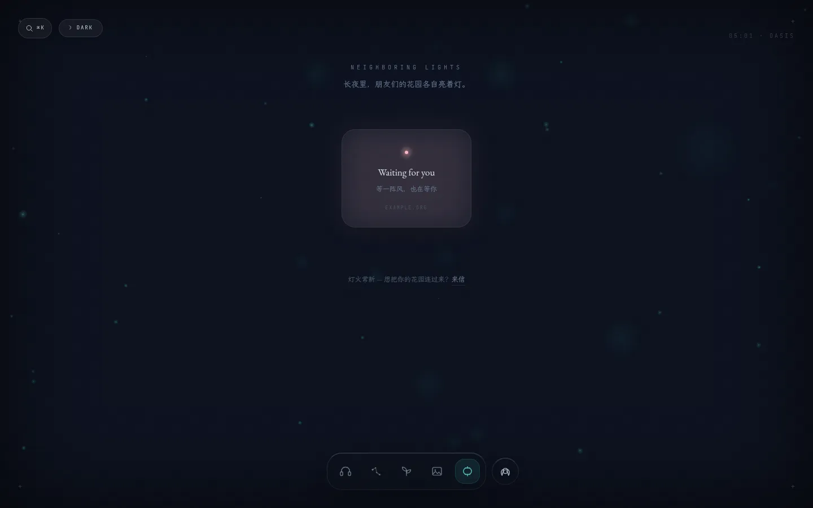
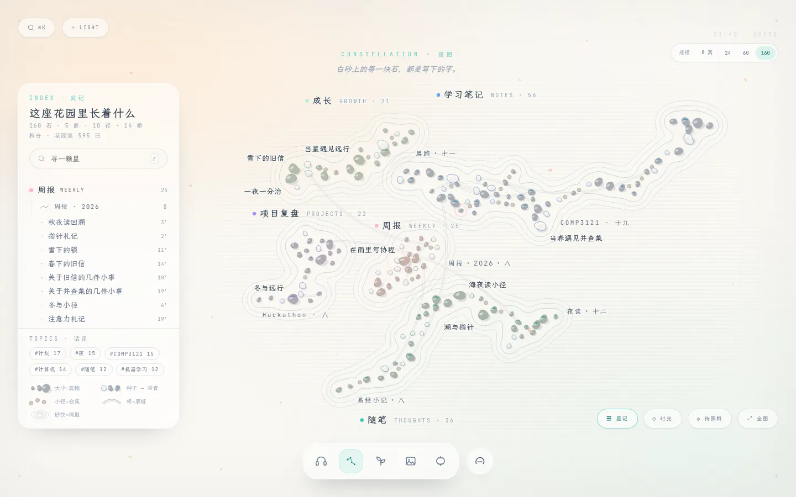
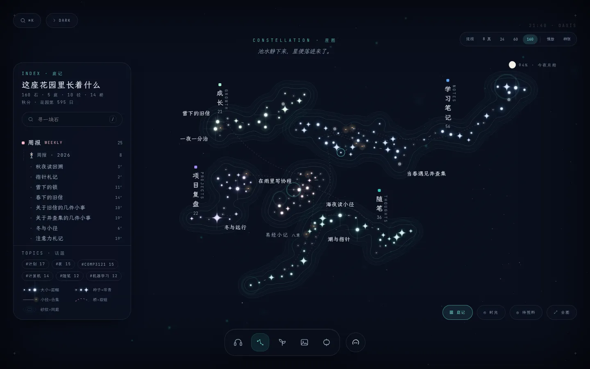
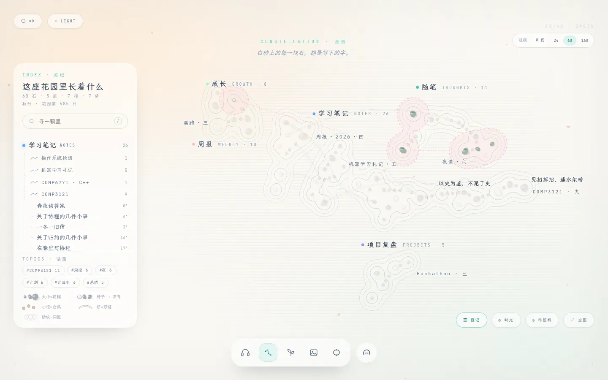
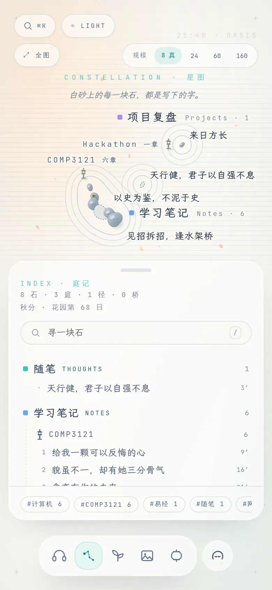

# 星图 · 第四轮重构方案「砂与星」

> 对象：[OasisOrchard.tsx](../../src/components/OasisOrchard.tsx)（791 行）· [constellation.ts](../../src/lib/constellation.ts)（696 行）· [index.css](../../src/index.css) 的 `.oasis-sky` 段 · [OasisDock.tsx](../../src/components/OasisDock.tsx)
> 日期：2026-09-24（秋分）
> 配套：可交互原型 [sand-and-stars-prototype.html](sand-and-stars-prototype.html)。单文件、零依赖，用线上真实的 8 篇文章，另有 24 / 60 / 160 篇的规模模拟；昼夜切换、选中、话题圈、时光拨盘、窄屏都能直接操作。**下文所有截图都来自它，数字都是在它上面量出来的。**
> **细节规格与落地方案见 [constellation-v4.1-detail-spec.md](constellation-v4.1-detail-spec.md)**：石与星的字形、颜色与尺寸、字与版、动效编排、素材、代码级工单。两篇有出入时以 v4.1 为准。本文的截图已经换成原型 v2。
> 前情：第一轮力导图 → 第二轮年轮盘（[constellation-redesign.md](../constellation-redesign.md)）→ 第三轮星野刻本（[04-sky-ye.md](../redesign-2026-08/04-sky-ye.md)，即线上现状）

---

## 0. 三句话结论

1. **割裂的根源不在哪个颜色上。星图是全站唯一一个「把窗关上」的场所。** 它自己画了一块不透明的天幕，把花园里的空气挡在外面：纸色和季节光、四季落叶和夜里的萤火、玻璃卡片、涟漪。然后又换上一整套宋刻本的语汇：乌丝栏、款识、闲章、朱砂。每一处单看都讲究，放在一起就成了另一个网站。
2. **解法叫「砂与星」：几何只有一套，白天看是枯山水，夜里看是星池。** 文章是石，到夜里是星。合集是飞石小径，夜里是星座连线。双链是石桥，夜里是鹊桥。同一分类的石子外面围一圈砂纹，这圈砂纹就是距离场的等值线。全站的两个关键词「禅意」和「水波涟漪」，在这里不再是点缀，成了星图的主体语言。砂纹用的也正是 Bubble Sets 的等值线算法，画面和功能由同一段代码生成。
3. **功能上，星图要从「一幅画」变成「一份空间目录」。** 分类是庭，合集是小径，文章是石。地图旁边加一条「庭记」目录栏，和地图双向联动，两者是同一份目录的两种写法。选中一篇就显示它的邻居，并注明每条连接的原因。手机端回到 Dock，以目录为主、缩略地图为辅。

| 现状 · 昼 | 砂与星 · 昼 |
|---|---|
|  |  |
| **现状 · 夜** | **砂与星 · 夜** |
|  |  |

---

## 1. 诊断

### 1.1 放在一起看

我在 1440×900、昼夜两态下把五个场所都截了图，数据是真实的 8 篇。花园、共鸣、灯火、绘阁四处用的是同一套语言：透明的底，底下露出暖纸色或夜墨色，四季的落叶或萤火在上面飘；面板是圆角玻璃；按钮是等宽小字的 pill；页头居中，上面一行英文等宽小字，下面一句衬线斜体。星图是唯一的例外。

| 花园（全站语汇） | 灯火（全站语汇） |
|---|---|
|  |  |

### 1.2 八处割裂（都有代码依据）

| # | 维度 | 全站其他场所 | 星图现状 | 依据 |
|---|---|---|---|---|
| 1 | 空气 | 底是透明的，露出 App 的暖纸 `#FAF8F3`、`termTint()` 季节光，还有 `OasisBackground` 的落叶和萤火 | `.oasis-sky` 自己画了一块不透明的径向渐变天幕，把这些全部盖住 | [index.css:575](../../src/index.css#L575)、[:605](../../src/index.css#L605) |
| 2 | 夜色 | 夜墨 `#0A0F1D`，藏青 | `#11242C → #081219`，青灰。同一个「夜」用了两种颜色 | [index.css:581](../../src/index.css#L581) |
| 3 | 形状 | rounded-full 的 pill、rounded-3xl 的玻璃卡、柔和阴影（Dock / 灯火 / 花园） | 2px 直角、0.5px 发丝框、双线版框、四角角记 | [OasisOrchard.tsx:715](../../src/components/OasisOrchard.tsx#L715)、[:744](../../src/components/OasisOrchard.tsx#L744)、[index.css:792](../../src/index.css#L792) |
| 4 | 色彩 | 强调色只有两个：初音绿、樱粉。分类色来自 AURA（随笔是绿、笔记是蓝、项目是紫……） | 分类色另起了一套 O–M 光谱：随笔是暖橙 `#FFCBA4`，笔记是冷白 `#EAF1FA`。**同一篇文章在博客里是蓝色，到星图里变成白色。** 白天整张图是灰墨，再加一枚朱砂闲章，而朱砂在全站其他地方都没有出现过 | [OasisOrchard.tsx:47](../../src/components/OasisOrchard.tsx#L47)、[index.css:501](../../src/index.css#L501)、[:511](../../src/index.css#L511) |
| 5 | 文化语汇 | 日式动漫里的禅：Miku、Yorushika、樱、落叶，配英文等宽小标 | 宋刻本：款识「星野」、乌丝栏、闲章「洲」、干支 | [OasisOrchard.tsx:657](../../src/components/OasisOrchard.tsx#L657)、[:687](../../src/components/OasisOrchard.tsx#L687) |
| 6 | 页头 | 居中：一行英文等宽 eyebrow，下面一句衬线斜体（NEIGHBORING LIGHTS / 长夜里，朋友们的花园各自亮着灯。） | 左上角一块带框的款识 | 截图 |
| 7 | 动效 | 涟漪（RippleBloom、ClickRipples、头像的 `oasis-ripple`）、呼吸、浮沉 | 全是静止的，选中一颗星也没有任何水波 | — |
| 8 | 在场 | 五个场所在手机 Dock 上都有入口 | 窄屏上整块撤掉，Dock 少了一格；从直链进来只剩一句「请到电脑上展开」 | [OasisOrchard.tsx:460](../../src/components/OasisOrchard.tsx#L460)、[OasisDock.tsx:105](../../src/components/OasisDock.tsx#L105) |

### 1.3 功能缺口

**作为目录：**
- L0 只标出 3 个名字（最亮的一颗，加上两个分类里各自唯一的那篇），8 篇里有 5 篇没有名字。「分类 → 合集 → 文章」这一层目录关系，在图上看不出来。
- 没有列表，没有图内搜索，不能按分类或话题筛选。图例只起装饰作用。
- 分类只认硬编码的 3 个（`TINT`）。`weekly`、`growth` 和所有自定义分类都被染成随笔的颜色，图例也永远只列这 3 类（[OasisOrchard.tsx:47](../../src/components/OasisOrchard.tsx#L47)、[:672](../../src/components/OasisOrchard.tsx#L672)）。

**作为关系图：**
- `buildGraph` 已经算出 wikilink、shared-tag、nebula 三类边，**界面上一条都没有画**：OasisOrchard.tsx 里对 `graph.links` 的引用是零。唯一上屏的关系是合集连线。
- 星卡里没有「相关文章」，只有合集内的前一篇和后一篇。

### 1.4 前三轮留下的好东西（全部保留）

- **落座之后永不迁移。** `layoutStars` 满足前缀不变量；`MIN_SEP` 保证命中区互不相交；拾取用最近邻。
- **相机不进 React。** `viewRef` 加上直接写 transform。反向缩放的那个坑（`--sky-scale` 必须声明在写它的那个元素上）继续有效。
- **星等 = 篇幅。** 门限贴着真实数据定：7 / 12 / 18 / 25 分钟。
- **不撒假星。** 装饰层不许冒充数据。
- **昼夜是同一张天，只换光。** 本方案把这条推到底：隐喻都换了（石 ↔ 星），几何一个像素都不动。
- **注记的做法。** 八方位择位，量一次真实宽度，不拉长引线。

需要推翻的只有两条：窄屏撤场（见 §5.7），以及「版面自带天幕」（见 §4.3）。

---

## 2. 设计命题

> 星图不是另一个世界。它是同一座花园，换了一个视角：**俯瞰**。

五条原则：

1. **同一片空气。** 星图不画自己的天。底是透明的，继承 App 的纸色和夜墨、季节光、落叶和萤火。在这个场所里粒子降到 60%，免得干扰读图。
2. **同一套语汇。** 形状（圆角玻璃、pill）、字体、色板、动效曲线（`[.16,1,.3,1]`）、页头格式，全部取自现有令牌。唯一新增的颜色是石色，而且只当材质用，不带语义（见 §4.3）。
3. **每一笔美术都在编码数据。** 没有纯装饰层。砂纹表示聚落，飞石表示次序，桥表示引用，苔和芒表示常青，水纹表示最近照料过。纯材质只有耙出的直纹、落叶/萤火和月亮，它们都不占据「数据所在的位置」。
4. **先是目录，再是画。** L0 一眼看过去就得能当目录用：每片庭的名字和篇数、每条小径的名字都常驻显示。
5. **关系的形状跟着关系的结构走。** 集合画成面（等值线圈），序列画成路径（飞石），两两之间的引用画成弧（桥）。结构不同的关系不共用一种线。共享标签永远不画成常驻连线，那正是毛线团的来源。

---

## 3. 借鉴了什么，用在哪里

| 作品 / 研究 | 学到的精髓 | 落在本方案的哪里 |
|---|---|---|
| **枯山水 · 龙安寺石庭** | 15 块石分成 5 组，其余全是耙过的白砂。石周围的同心砂纹（水紋）是「石头破开水面的涟漪」，直纹是静水 | 昼态的主体：文章是石，砂纹围着石，庭与庭之间是直纹白砂 |
| **银阁寺 · 银沙滩与向月台** | 相传那片白砂是为了在月夜反光而耙的。同一座庭，有白天和夜里两种看法 | 昼夜同构的出处：夜里砂纹变成星池上的星晕 |
| **回游式庭园的飞石** | 一块块踏石规定了怎么走、走的节奏 | 合集是飞石小径（昼）或星座连线（夜）；键盘 `←/→` 沿小径一块一块踩过去 |
| **七夕 · 鹊桥** | 跨过河把两边连起来 | 双链是石桥（昼）或樱粉虚线鹊桥（夜） |
| **Outer Wilds 的飞船日志** | 同一批条目有两种视图：Map Mode 按地点排，Rumor Mode 按关联排；每条连线都写明是哪条线索连起来的 | 地图按「地点」、庭记目录按「层级」，两者互为另一半；每条关系都附带原因 |
| **Sky 光·遇 的星盘** | 每个国度是一个星座，先祖是其中的星；星座既是进度，也是入口 | 分类是庭，合集是星座，两者都可以点进去 |
| **Bubble Sets**（Collins、Penn、Carpendale，2009） | 不改动原有布局，只用等值线把集合的成员圈出来 | 话题圈：只用该话题的成员重算一次距离场，取其中一条等值线 |
| **KelpFusion**（Meulemans 等，2013） | 在凸包和生成树之间取中：成员散得很开时，用连线代替一个巨大的泡。受控实验中，准确率和耗时都优于 Bubble Sets | 话题成员相距太远时，改用最小生成树的点线把它们连起来 |
| **Quartz / Obsidian 的局部图谱** | 全局图给人看，局部图给人用；全局图过了一百篇必然变成毛线团 | 选中即局部图：只点亮一跳以内的邻居，并在卡片里分三类列出 |
| **Maggie Appleton · Topography over timelines** | 花园按地形组织，而不是按时间 | 星图的定位是地形视图；时间交给「时光」拨盘 |
| **Nadieh Bremer · Royal Constellations** | 3000 颗星照样可读：暗色底、克制的连线、路径只在交互时才显现 | 160 篇时的细节分级：庭名常驻，星名按星等配额，关系按需出现 |
| **分野**（中国古代天文） | 天上的区域和地上的州国一一对应 | 分类对应天区（庭）的文化依据，也是它能当目录用的原因 |

---

## 4. 概念：砂与星

### 4.1 一张图，两种光

| 数据 | 昼 · 砂庭 | 夜 · 星池 |
|---|---|---|
| 文章 | 石 | 星 |
| 篇幅（星等 1–5） | 石的大小（屏幕上 4.4–11.2px）和石高（影长） | 星核大小，加光晕 |
| 生长度 | 种子是虚线空心卵石；生长中是实心石；常青的石上覆一块苔（苔绿，与分类无关） | 种子是暗星加虚线环；生长中是亮星；常青带四角芒 |
| 分类 | **庭**：一组石，一个庭名，外面一圈带分类色的砂纹 | **天区**：一片星，一个区名，外面一圈淡色星晕 |
| 合集 | 千鳥打ち的飞石小径，入口立一盏石灯笼（第一章） | 星座连线，灯笼夜里点亮 |
| 双链 | 石桥（双线弧） | 鹊桥（樱粉虚线弧） |
| 话题（标签） | 悬停或固定时出现：樱粉虚线圈，加生成树点线 | 同左 |
| 三周内照料过 | 石边荡开樱粉水纹，5 秒一圈 | 初音绿水纹 |
| 选中 | 初音绿圆环，加一次涟漪 | 同左 |
| 背景材质 | 耙成直纹的白砂（外缘渐隐），加秋叶 | 几乎看不见的水面，加萤火和今夜真实的月相 |

160 篇时（真实 8 篇加模拟数据）：

| 昼 | 夜 |
|---|---|
|  |  |

### 4.2 为什么选枯山水

- **全站的关键词写在 CLAUDE.md 里：禅意、水波涟漪。** 枯山水就是这两个词在庭园里的原型；背景里本来就飘着落叶和萤火。
- **文化语境对得上。** 它和 Miku、Yorushika、樱花同属日式语境，替换掉与之冲突的宋刻本语汇。
- **稀疏的时候也不空。** 8 篇文章同样是一座完整的石庭，龙安寺也只有 15 块石。前三轮一直在跟「稀疏时空」较劲，这个问题在这里不存在。
- **砂纹就是距离场的等值线，也就是 Bubble Sets。** 画面和信息由同一段代码生成，没有「为了好看另画一层」。
- **昼夜同构有出处。** 银沙滩相传是为映月而耙的。

### 4.3 色彩：只用全站已有的颜色

| 用途 | 昼 | 夜 | 来源 |
|---|---|---|---|
| 底 | 透明，露出 App 的 `#FAF8F3` 和 `termTint()` | 透明，露出 App 的 `#0A0F1D` | App.tsx |
| 墨 | slate-700 `#334155` / 500 / 400 | slate-200 / 400 / 500 | 全站正文 |
| 强调 | `#39C5BB`（线），`#1B7A74`（小字，4.5:1） | `#66DED5` | Dock、index.css |
| 次强调 | 樱粉 `#FFB7C5`：话题圈、新近水纹、鹊桥 | 同左 | 全站 |
| 分类 | `metaOf(type).color`（AURA），与博客的分类 chip 同一来源 | 同左 | useCategories |
| 石 | 白鼠与銀鼠混合，兑 20% 分类色（详见 v4.1 §1.4） | 不出现 | **唯一新增**：取自日本传统色，只当材质用 |

- **删除：** `--sky-sp1..5` 光谱阶、`--sky-seal` 朱砂、`--sky-hi/lo` 天幕、双线版框。
- **小字里的分类色**一律用 `.oasis-accent-ink` 那种写法：白天 `color-mix(in oklab, c 45%, #1e293b)`，夜里 88% 兑 `#f8fafc`。这样 mint `#A7F3D0` 这种浅色写成小字也能达到 4.5:1。

### 4.4 字与版

- **页头照全站格式：** `CONSTELLATION · 星图`，下面一句衬线斜体。白天是「白砂上的每一块石，都是写下的字。」，夜里是「池水静下来，星便落进来了。」
- **字号沿用现有阶梯 16 / 13 / 11 / 10：** 庭名 16（LXGW WenKai）配 10 号等宽英文；小径名 11 号等宽（中文名用 12 号文楷）；星名 13；元信息 10 号等宽。
- **所有注记在屏幕上保持恒定尺寸**，并描一圈底色描边（`paint-order: stroke`），压在砂纹上也读得清。
- **没有版框。** 边界由砂自己定义：直纹在外缘渐隐，融进纸色。

### 4.5 形与材质

- **面板：** 24px 圆角玻璃，配方和灯火的光茧、Dock 相同（`bg-white/55`、`border-white/70`、`blur 20`、阴影 `0 18px 50px -30px`）。
- **按钮：** 和左上角 ⌘K、主题切换同款的 pill。
- **石：** 12 个点的种子化卵石轮廓（两道低频起伏，俯视略扁，随机转角），右下加投影，左上加高光。全部程序生成，不用一张位图，天然适配任意分类色和昼夜两态。

### 4.6 动效（只动 transform / opacity）

| 时机 | 动作 | 参数 | reduced-motion |
|---|---|---|---|
| 进场 | 石按种下的先后逐块落定（原型里没有做，交给实现） | 总时长 ≤ 900ms | 直接出现 |
| 选中 | 石心荡开两圈水纹（先绿后粉，间隔 180ms） | 1.5s，BLOOM_EASE | 不播 |
| 相机 | 飞向目标 | 640ms，`[.16,1,.3,1]` | 瞬移 |
| 新近照料 | 每 5 秒荡一圈 | 无限循环，相位按种子错开 | 静态一圈 |
| 昼夜 | 石与星交叉淡入淡出 | 1s，与 App 的 1500ms 换天同步 | 瞬换 |

---

## 5. 信息架构：一份目录，两种形态

### 5.1 三层动线（沿用 L0/L1/L2 的框架，内容重写）

| 层 | 回答的问题 | 内容 |
|---|---|---|
| L0 一望 | 这里长着什么 | 庭名加篇数（常驻），小径名（常驻，数量配额随缩放放宽），一等星的名字；庭记目录同屏显示 |
| L1 认星 | 这篇和谁有关 | 悬停：小径亮起，邻居的名字浮出，目录中对应的行高亮。点击：一圈水纹，打开星卡（三类关系，各附原因） |
| L2 细读 | 读全文 | 「进入阅读舱」跳到 `#/garden/<id>`。星图内仍然不做长文阅读 |

### 5.2 庭记（目录栏）

- **结构：** 庭（分类，按开垦先后）→ 小径（合集，按首篇时间；章节号是它在合集里的序号）→ 散石（按时间倒序）。每行右侧是阅读分钟数。
- **双向联动（brushing & linking）：**
  - 悬停庭名，这片庭以外的石都变暗；悬停小径，那条飞石亮起；悬停文章，地图上那块石和它的邻居亮起。
  - 点击任何一行，相机飞过去；在地图上悬停，目录滚动到对应的行。
- **搜索：** 按 `/` 聚焦，匹配标题、话题和合集名，目录和地图同时过滤；按回车选中第一个结果。
- **话题：** 列出频次最高的 14 个标签。悬停出现临时话题圈，点击则固定下来。
- **图例：** 和地图用同一支笔画（共用 `glyph()`），所以图例和图上永远一致。
- **可收起：** 桌面端向左滑出；手机端把抽屉往下拉即可收起。

### 5.3 星卡

- 顶部是分类 chip（和博客卡片用同一个组件），以及合集 chip，例如「COMP3121 · 第三章」。
- 下面是标题、元信息（日期 · 分钟 · 生长度 · 几天前照料）和摘要。
- **关系分三段，每段都写明原因：**
  - **小径：** 合集的进度条（每块踏石都能点）以及前后篇。
  - **桥：** → 表示这篇引用了谁，← 表示谁引用了这篇。没有桥时给一句写作提示：「写下 [[标题]] 就会架起一座」。
  - **同话题：** 最多 5 篇，右侧注明共享的 #标签；已经在同一条小径上的不重复列出。
- 主按钮是「进入阅读舱 →」，实心初音绿 pill。
- **卡片出现时相机会让位。** 如果这颗星被卡片或目录挡住，就平移到可见区域；天空不会消失，也不会重排。

### 5.4 局部图

- 选中后，本星、所在小径的全部石、桥两端、同话题的前 5 篇会亮起，其余降到 24%。
- 同话题的关系只在选中时画出来：一组指向本星的点线辐条，悬停时显示原因。这些线永远不常驻。

### 5.5 话题圈（Bubble Sets 加 Kelp）

- 只用该话题的成员重算一次距离场，取 30px 那条等值线，画成樱粉虚线，填充 12%。
- 成员之间相距超过 60px 时，不会硬把它们包进一个大泡，而是用最小生成树的点线串起来。

### 5.6 键盘与地址

- `/` 搜索，`Esc` 关闭卡片或清空搜索，`←/→` 沿小径前后移动（散石按时间顺序），`Enter` 进入阅读舱。
- `#/constellation/<id>` 记录选中状态：可以分享，刷新也不会丢（route.ts 的 `ITEM_VIEWS` 已经包含 orchard）。

### 5.7 手机：收回「窄屏不做」这条决定

| 首屏 | 选中 |
|---|---|
|  |  |

- Dock 恢复星图入口：删掉 [OasisDock.tsx:105](../../src/components/OasisDock.tsx#L105) 的那段过滤。
- **布局：** 上半屏是缩略地图，可以捏合、拖动；下半屏是庭记抽屉（44vh），下拉可收起，看整片庭。
- **选中：** 卡片替换抽屉，地图把「这颗星和它的邻居」重新取景到卡片上方。
- **避让：** 注记不会落到抽屉后面；窄屏不画月相，也隐藏「时光」「照料」两个按钮。

第三轮撤掉手机版，是因为那张横版的版心在竖屏上只会缩成一条窄带。现在版心没有了，目录又成了主体。「列表加小地图」正是手机上最常见、也最好用的形态，地图类应用基本都是这么做的。

### 5.8 时光拨盘（P3，原型里已经能玩）

拖动拨盘，花园会按写作的先后一块一块长出来，旧石一动不动。这是「落座之后永不迁移」这条不变量最直观的演示，也是这个页面里最值得录屏的几秒钟。

---

## 6. 布局与绘制算法

### 6.1 落座：在「落座后永不迁移」之上加一层「庭」

- **庭址。** 第 k 个出现的分类在黄金角螺线上取一个庭址：`θ = k·137.5° + 0.74 rad`（加 0.74 是为了让第二片庭落在正左，横版更舒展），`r = 270·√k`，纵向压缩到 0.66。庭址一旦取定就不再变。
- **庭内的每一篇文章：**
  - 已有合集：从小径末端沿着原来的走向续一步。转角在 ±48° 以内，偶尔出现一个硬拐，步长在 0.72–1.47 × 54 之间。
  - 新合集：在庭内另起一处，离庭心 1.6 步。
  - 散文：先找同一片庭里有共同话题的「亲戚」，落在它旁边；找不到就绕着庭心落。
- **候选评分。** 每篇文章在 10 圈 × 18 个方向上取候选点，分数为：
  `圈数×9 + 偏角×8 + 到庭心的距离×(合集 0.1 | 散文 0.14) + Σ 120 以内别庭的石 (120−d)×2.4 + Σ 64 以内同庭别的小径 (64−d)×0.8`
  离任何已有的石不足 `MIN_SEP` 的候选直接淘汰。
- **性质。** 每一步只看已经落好的石，所以 `layout(posts[:k])` 恒为 `layout(posts)` 的前缀，新文章不会移动任何旧石。任意两石的间距 ≥ `MIN_SEP`，所以命中区互不相交。**第三轮的两条测试不变量原样成立。**

**原型实测**（Chromium，1440×900，每项取 5 次的平均）：

| 篇数 | 8 | 60 | 160 | 300 | 600 |
|---|---|---|---|---|---|
| 落座耗时 | 2.5ms | 16ms | 36ms | 73ms | 143ms |
| 砂纹耗时（全部庭 × 3 条等值线） | 11ms | 40ms | 64ms | 114ms | 213ms |
| 前半数据落座后在全量里的最大位移 | **0** | **0** | **0** | **0** | **0** |
| 最小间距（MIN_SEP = 30） | 40.4 | 30.2 | 30.4 | 30.1 | 30.0 |
| 离自家庭址比离别家近的石 | 100% | 85% | 94% | 73% | 62% |

最后一行是已知的弱点：超过 300 篇后，长合集会把庭拉成长条，伸进邻庭。对策见 §10：庭址间距按「已占面积」自适应，并且庭心引力随庭的大小增强。两种都只影响新落的石，不破坏前缀不变量。

### 6.2 砂纹：smooth-min 距离场加 marching squares

- **场函数：** `f(p) = −K · ln Σᵢ exp(−(|p − sᵢ| − Rᵢ)/K)`，其中 K = 7px。只有一块石时，它就是到石边的距离；几块石挨近时，等值线会自然合拢。耙砂围石就是这个样子，Bubble Sets 的等值线也是这样算出来的。
- **每片庭各算一套。** 取三条等值线（屏幕上 9 / 17 / 25px），描边兑 34% 分类色。最外那一圈同时当两样东西用：直纹的蒙版洞（直纹在那里停住），以及夜间水面的淡色填充。
- **网格：** 3.2px 一格，上限 16 万格；每个格点只查 3×3 个分桶里的石。缩放分四档（×1 / 1.8 / 3.2 / 5.6）重算，拉近时每块石的砂纹会从聚落里分离出来。
- **生产实现的建议：**
  - 放进 `lib/sandField.ts`，写成纯函数，可以单测。
  - **按庭缓存。** 新增一篇文章只需要重算它所在的那片庭。
  - 超过 300 篇时挪进 Web Worker。
  - 目标：主线程每次阻塞 < 50ms。

### 6.3 注记

- **在屏幕空间择位，分三轮：**
  1. 庭名。按庭的大小依次放，优先选「离它最近的石属于本庭」的位置，否则名字会被读成邻庭的。
  2. 小径名。先试小径包围盒外的四个方向，再试沿线的位置。
  3. 星名。优先级是：焦点和邻居 > 小庭里仅有的那一两篇 > 星等配额（按缩放档位分别为 ≥5 / ≥4 / ≥3 / 全部）。
- 星名的八方位沿用第三轮的优先级：右上 → 左上 → 右下 → 左下 → 上 → 下 → 右 → 左。宽度只量一次。
- 配额随缩放放宽：小径名 8 / 14 / 30 / 全部，星名 10 / 22 / 48 / 全部。

### 6.4 渲染

- 仍然用 SVG，和现状一致。
- 节点的符号组用 `transform=scale(1/k)` 保持屏幕尺寸不变；所有线都用 `vector-effect: non-scaling-stroke`。飞石是一条圆头 `stroke-dasharray` 的线，不额外增加节点。
- 相机仍然全程不进 React。悬停只改 class（dim / lit / sel），不重建节点；注记在相机停稳 110ms 后重排。

---

## 7. 美术素材

| 素材 | 用途 | 来源与许可 | 结论 |
|---|---|---|---|
| 卵石轮廓、砂纹、飞石、桥、芒 | 画面主体 | 程序生成 | **采用。** 不用位图，任意分类色、昼夜两态都成立 |
| 秋叶、萤火 | 空气 | 现有的 `OasisBackground` | **沿用。** 在星图场所里降到 60% |
| `public/textures/noise-128.png` | 白砂的颗粒感 | 仓库里已有 | 可选：`hidden md:block`，opacity .03 |
| [ambientCG](https://ambientcg.com/) 砂砾 / 纸张材质 | 更实在的砂质感 | CC0 | 可选：烘成 256px 的 webp 平铺，≤ 30KB，移动端不加载 |
| 今夜月相 | 夜里唯一的装饰，同时也是真实数据 | 计算得出（朔望月 29.53 天） | **采用**（原型里已经有） |
| [Yale 亮星星表 BSC5](http://tdc-www.harvard.edu/catalogs/bsc5.html) | 把夜里的星尘换成「真实的天空」：站主所在纬度，当晚的恒星时 | 天文基础数据，由 Harvard CfA 分发 | 可选，P3。只取 mag ≤ 5，约 1600 颗，≈ 20KB gz；仍然守住「不撒假星」 |
| [NASA SVS · Deep Star Maps 2020](https://svs.gsfc.nasa.gov/4851) | 夜里的银河带 | NASA 出品，公有领域 | 可选，P3。烘成一张 1024×512 的低饱和 webp |
| 字体 | EB Garamond / LXGW WenKai / JetBrains Mono | 仓库里已有 | 不新增 |
| **不采用** | 手绘或 AI 生成的石材位图、3D 星空、第三方图谱库 | — | 位图石没法随分类色和昼夜换装；3D 和图谱库导航更差，包也更大 |

---

## 8. 代码改造清单

### 8.1 文件

| 文件 | 改动 |
|---|---|
| `src/lib/constellation.ts` | `layoutStars` 加上「庭」这一层和候选评分。确认没有引用之后，删掉年轮盘遗留的 `densityByTerm`、`annularSector`、`arcPath`、`relaxColumn`、`bandsFor`、`SKY_*`。`buildGraph` 保留 series / wikilink / shared-tag，去掉 nebula hub |
| `src/lib/sandField.ts`（新建） | `sandField()`、`iso()`（marching squares）、`joinSegments()`、`smoothPath()`，全部是纯函数。原型里现成的实现可以直接移植 |
| `src/components/constellation/`（新目录） | 把 791 行的单文件拆开：`SkyStage.tsx`（SVG、相机、拾取）、`Glyph.tsx`（石和星用同一支笔，图例复用它）、`IndexRail.tsx`（庭记）、`StarCard.tsx`、`useSkyCamera.ts`、`placeLabels.ts` |
| `src/components/OasisOrchard.tsx` | 缩成 60 行左右的组装层；文件头的五条规矩重写（见 §8.3） |
| `src/index.css` | 重写 `.oasis-sky` 段：删掉天幕 background、光谱阶、朱砂、版框；新增 `--ring-*`、`--stone`、`--step`、`--bridge`，昼夜各一套 |
| `src/components/OasisDock.tsx` | 删掉窄屏过滤 |
| `src/components/OasisGallery.tsx` | 把 `GrowthGlyph` 和分类 chip 抽成共享组件，给星卡复用 |
| `src/App.tsx` | 可选：给 `OasisBackground` 传一个 `dim` 参数，在星图场所里设为 0.6 |
| `CLAUDE.md` / `AGENTS.md` | 里面对星图的描述还是「年轮盘」，已经过时两轮了，随实现一起更新 |

### 8.2 测试

- **保留：** 新增文章不移动旧星；任意两石的间距 ≥ `MIN_SEP`；前缀不变量。
- **新增：**
  - 庭址稳定：新增一个分类，不改变已有的庭址。
  - 同庭聚集：在 N ≤ 160 的样本里，至少 85% 的石离自家庭址比离别家近。这个阈值来自 §6.1 的实测。
  - `iso()`：单点场的等值线是闭合的近圆，半径误差小于一格；两点相距 < 2L 时，同一条等值线只有一个环。
  - 性能：300 篇时 layout 加 sandField < 120ms。这是单测环境的上限，写法沿用现有的耗时断言。
- **视觉验收：** 注记零重叠，沿用 04 号文档里的 console 脚本。

### 8.3 新的五条规矩（替换文件头）

1. **同一片空气。** 星图不画背景，颜色只从全站令牌里取。
2. **每一笔都在编码数据。** 纯材质只有直纹、落叶/萤火和月。
3. **昼夜同几何。** 石 ↔ 星，飞石 ↔ 连线，石桥 ↔ 鹊桥，只换光。
4. **相机不进 React。** 符号和注记保持恒定屏幕尺寸；命中区由 `MIN_SEP` 保证互不相交。
5. **关系按结构选形。** 集合画成面，序列画成路径，引用画成弧；共享标签不画常驻连线。

---

## 9. 分期

| 期 | 内容 | 工作量 | 判据 |
|---|---|---|---|
| **P0 · 融入**（先止血） | 删掉天幕和刻本语汇；令牌换成全站的；页头、按钮、星卡换成玻璃和 pill；分类色改用 `metaOf().color`，支持任意分类；图例动态生成 | 0.5–1 天 | 现有星野在昼夜两态下的截图，和其他四个场所放在一起不跳；同一篇文章在博客和星图里是同一个颜色 |
| **P1 · 目录** | 庭记目录栏、双向联动、搜索、键盘；星卡的三段关系；手机回归（抽屉加缩略地图） | 2–3 天 | 不碰地图，只用目录就能走到任何一篇；选中之后能说出每个邻居为什么相连 |
| **P2 · 砂与星** | 庭式落座；砂纹等值线；石和星的双态字形；飞石和桥；局部图；话题圈 | 3–4 天 | 8 篇和 160 篇的截图都成立；测试全绿；主线程每次阻塞 < 50ms |
| **P3 · 光** | 时光拨盘；新近水纹；月相；可选的 BSC5 真实星空；Miku 在星图上说一句话 | 1–2 天 | 能录下一段 10 秒的「花园生长」 |

P0 和 P1 不依赖新布局，可以先上线。P2 才是真正的重做。

---

## 10. 风险与对策

| 风险 | 对策 |
|---|---|
| 白天的石头被当成装饰，看不出是文章 | 石有名字，悬停即亮，目录同步高亮。原型里 8 篇的时候，每片庭都有常驻的名字 |
| 分类很多（自定义分类超过 8 个） | 螺线庭址天然能往外扩；目录栏可以折叠；分类至少有 1 篇文章才开庭 |
| 一条长合集把庭拉成长条（160 篇时的 COMP3121；300 篇以上时的聚集度只剩 73%） | 庭心引力随庭的大小增强（`0.1 → 0.1 + 0.002·n`）；庭址间距按已占面积自适应（新庭址取「已有庭址的外接圆半径 + 一个庭的直径」）；庭名按重心落位，不按包围盒。三种都只影响新落的石 |
| 砂纹计算耗时 | 按庭缓存，按缩放档位缓存，16 万格上限，放进 Worker；只在数据或缩放档位变化时重算 |
| 和 Miku、落叶抢层级 | 星图场所里背景粒子降到 60%；Miku 的泊位避开目录栏和星卡（`data-oasis-avoid`） |
| 夜里砂纹几乎看不见 | 这是有意的：夜的主角是星。砂纹只保留 .09 / .17 的透明度，暗示一片池面；选中或悬停时，小径和邻居会亮起来 |

---

## 11. 不做什么

- 不做 3D 星空，不引入第三方图谱库。
- 不画常驻的共享标签连线（那就是毛线团）；标签只以「圈」的形式出现，而且只在需要时出现。
- 不把年轮盘或时间轴放回来当底图；时间交给「时光」拨盘。
- 不为了好看添假石、假星；空的地方交给白砂和夜色。
- 不在星图内做长文阅读。

---

## 12. 验收

1. 把星图的昼夜截图和花园、灯火并排放，没有任何一处需要解释「为什么这里不一样」。
2. 只看地图、不看目录，能说出有几个分类、每个分类下有哪些合集、最长的是哪一篇。
3. 选中任意一篇，卡片能列出它的每一个邻居以及相连的原因（合集 / 双链 / 共享话题）。
4. 在 390×844 的屏幕上，能从 Dock 进入，能搜索，能选中，能进阅读舱。
5. 新增文章后没有任何旧石移动；时光拨盘从头拖到尾，老石一动不动。
6. 注记零重叠；`prefers-reduced-motion` 下没有持续动画；300 篇时主线程每次阻塞 < 50ms。
7. `npm run build`、`npm run lint`、`npm test` 全部通过。

---

## 附 A：怎么看原型

- **起服务：** 在仓库根目录跑 `npx vite`，然后打开 `/docs/redesign-2026-09/sand-and-stars-prototype.html`。字体从 `node_modules` 里取；直接双击打开会退回系统字体，其余功能不受影响。
- **URL 参数：** `?n=8|24|60|160` 控制规模，`&theme=night` 切到夜里，`&sel=p3` 预先选中一篇，`&topic=夜` 固定一个话题圈，`&time=520` 设置时光拨盘（0–1000），`&rail=off` 收起目录。
- **交互：**
  - 拖动、滚轮、捏合移动和缩放；悬停认石，点击开卡。
  - `/` 搜索，`←/→` 沿小径走，`t` 切换昼夜。
  - 右下角有「时光」「待照料」「全图」。

## 附 B：参考

- 枯山水砂纹的讲究：[7 Common Raking Patterns — NAJGA](https://najga.org/7-common-raking-patterns-in-japanese-dry-landscape-gardens/)、[Karesansui Meaning — Zen Craftworks](https://zen-craftworks.com/blogs/zen/zen-garden-meaning-karesansui-sand-stones)
- Outer Wilds 的飞船日志（Map Mode / Rumor Mode）：[Computer — Outer Wilds Wiki](https://outerwilds.fandom.com/wiki/Computer)、[UX Critique: The Outer Wilds](https://medium.com/super-jump/outer-wilds-a-ux-critique-part-2-146abcb9a5a1)
- Sky 光·遇 的星盘：[Constellations — Sky Wiki](https://sky-children-of-the-light.fandom.com/wiki/Constellations)
- Bubble Sets：[vialab 项目页](https://vialab.ca/research/bubble-sets)、[论文 PDF](https://vialab.ca/wp-content/publication_media/pdf/col2009c.pdf)
- KelpFusion：[Microsoft Research](https://www.microsoft.com/en-us/research/publication/kelpfusion-hybrid-set-visualization-technique/)
- 局部图谱：[Quartz · Graph View](https://quartz.jzhao.xyz/features/graph-view)
- 数字花园的「地形」：[A Brief History & Ethos of the Digital Garden — Maggie Appleton](https://maggieappleton.com/garden-history)
- 大规模星图的可读性：[Royal Constellations — Nadieh Bremer](https://www.visualcinnamon.com/portfolio/royal-constellations/)
- 公有领域星空素材：[NASA SVS Deep Star Maps 2020](https://svs.gsfc.nasa.gov/4851)、[Yale Bright Star Catalog](http://tdc-www.harvard.edu/catalogs/bsc5.html)、[ambientCG（CC0 材质）](https://ambientcg.com/)
